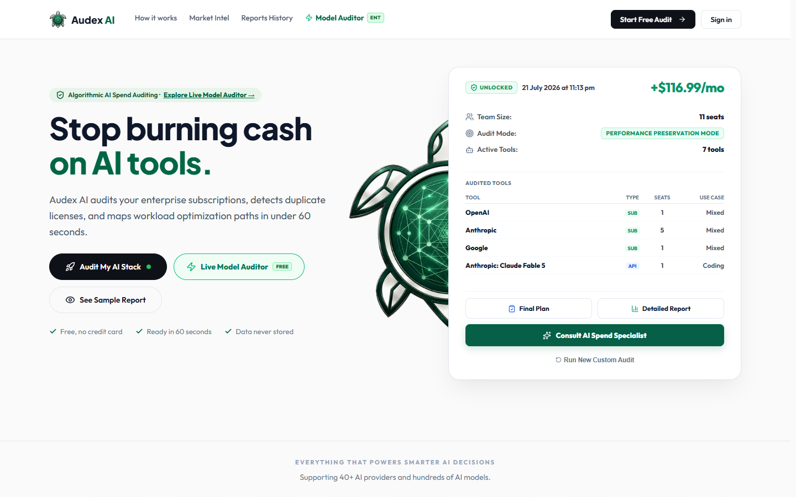
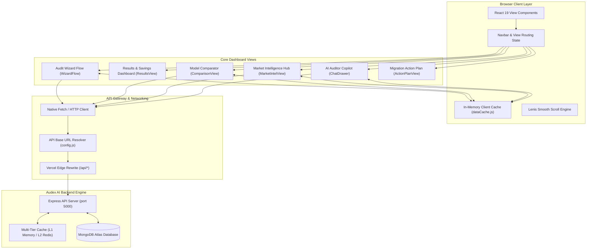
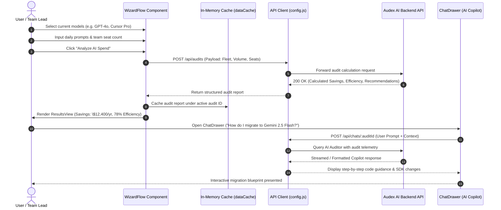

<div align="center">


# Audex AI — Modern Enterprise Web Client

**Next-Generation AI Model Intelligence, Spend Audit Dashboards, and Fleet Optimization Platform**

[](https://github.com/dhrub4545/Audex_AI_frontend)
[](https://opensource.org/licenses/MIT)
[](https://react.dev/)
[](https://vitejs.dev/)
[](https://tailwindcss.com/)
[](https://lucide.dev/)
[](https://vercel.com/)

---

## Application Screenshot & Interface Preview

<div align="center">
  
</div>

---

### 🔗 Companion Repositories & Live Deployment

| Component | Link | Description |
| :--- | :--- | :--- |
| ⚙️ **Backend API Engine** | [](https://github.com/dhrub4545/Audex_AI_backend) | Express, MongoDB Atlas, Redis, AI model pipeline |
| 🚀 **Live Production** | [](https://www.audexai.in) | Official production platform |

</div>

---

## 📌 Executive Summary & Problem Solved

As generative AI adoption scales across modern software companies, technical leaders and CFOs grapple with opaque AI expenditures. Developers frequently default to the newest flagship models (like Claude 3.7 Sonnet, GPT-4o, or Gemini 2.5 Pro) for trivial tasks where smaller, highly optimized models (like Gemini 2.5 Flash, DeepSeek V3, or Llama 3.3) perform identically at 80–90% lower token cost. Simultaneously, engineering teams waste thousands of dollars each month on redundant developer seat licenses across ChatGPT Plus, Claude Pro, Cursor Pro, and GitHub Copilot.

**Audex AI Frontend** provides an intuitive, high-performance web dashboard that demystifies AI spending:
1. **Interactive Audit Wizard**: Allows teams to specify their active AI models, daily prompt volume, token ratios, and seat counts in minutes.
2. **Instant Executive Analytics**: Computes immediate monthly and annual savings, efficiency scores (0–100), and side-by-side cost comparisons.
3. **Engineering Migration Blueprints**: Delivers actionable, code-level migration guides (with OpenAI SDK drop-in replacement snippets) to swap expensive endpoints safely.
4. **Real-Time Market Intelligence**: Displays live leaderboard rankings across 20+ specialized benchmarks (Coding, Reasoning, Math, Speed, Latency, and Cost).
5. **Conversational AI Auditor Copilot**: An interactive slide-out assistant that answers nuanced questions regarding model tradeoffs and migration risks.

---

## 🌟 Key Features

- 🪄 **Multi-Step Audit Wizard (`WizardFlow`)**: Guided 5-step flow capturing team size, current model stack, workload characteristics, and priority preferences (Quality vs. Speed vs. Cost).
- 📈 **Comprehensive Spend Analytics (`ResultsView`)**: Visual breakdown of API token burn vs. seat subscriptions, projected annual ROI, and waste elimination gauges.
- ⚔️ **Model Comparison Matrix (`ComparisonView`)**: Compare 2–4 models side-by-side across MMLU, Arena Elo, GPQA, SWE-bench, input/output token pricing, and time-to-first-token (TTFT).
- 🌐 **Live Market Intelligence Hub (`MarketIntelView`)**: Dynamic leaderboards tracking the top models across specialized categories (Fast, Cheap, Enterprise, Multilingual, Creative, Extraction).
- 💬 **Slide-out AI Copilot (`ChatDrawer`)**: Embedded chat assistant with instant answers on token pricing, model deprecation risks, and migration strategies.
- 📋 **Step-by-Step Action Plans (`ActionPlanView`)**: Turnkey implementation roadmaps with code examples and rollout timelines.
- 💳 **Seamless Razorpay UPI Billing**: Integrated modal for upgrading subscriptions, purchasing audit credits, and verifying instant UPI transactions.
- ⚡ **Ultra-Smooth UX**: Powered by Lenis smooth scrolling, Floating UI positioning, and client-side memory caching (`dataCache.js`) for near-zero latency navigation.

---

## 🏗️ System Architecture

The following diagram illustrates how the React 19 client coordinates with local caches, component state, Vercel edge routing, and the Audex AI backend:



---

## 🔄 User Journey & Data Flow

The sequence diagram below demonstrates the end-to-end user interaction through the audit wizard, calculation, and conversational AI consultation:



---

## 💻 Tech Stack

| Category | Technology | Version | Description |
| :--- | :--- | :--- | :--- |
| **Framework** | React | `19.1.0` | Latest React engine featuring optimized rendering and Hooks |
| **Build Tool** | Vite | `6.3.5` | Next-generation bundler with instant HMR and optimized chunking |
| **CSS / Styling** | Tailwind CSS & Modern CSS | Modern | Glassmorphism, responsive grids, and dark theme design |
| **Icons** | Lucide React & LobeHub | `1.23.0` / `5.10.1` | Crisp SVG vector icons and official AI brand logos (OpenAI, Anthropic, Claude, Gemini) |
| **Smooth Scrolling** | Lenis | `1.3.25` | Hardware-accelerated inertial smooth scrolling |
| **UI Positioning** | @floating-ui/react | `0.27.19` | Anchor positioning for dropdowns, tooltips, and floating menus |
| **Linter** | ESLint | `9.25.0` | Code quality enforcement with React Hooks lint rules |
| **Hosting & CDN** | Vercel | Production | Global edge network with automated SPA fallback routing |

---

## 📂 Repository Structure

```text
Audex_AI_frontend/
├── public/
│   ├── favicon.ico                   # Audex browser favicon
│   ├── icon-192.png / icon-512.png   # PWA application icons
│   ├── manifest.json                 # Web app manifest
│   ├── og-image.png                  # OpenGraph social preview banner
│   ├── robots.txt                    # Search crawler directives
│   └── sitemap.xml                   # Search engine index mapping
├── src/
│   ├── assets/                       # Brand graphics and AI vendor logos
│   │   ├── audex-ai-logo.png         # Alternative logo format
│   │   ├── Audex.png                 # Primary Audex AI logo
│   │   ├── claude.svg                # Anthropic Claude icon
│   │   ├── cursor.svg / cursor.png   # Cursor IDE icon
│   │   ├── gemini.svg                # Google Gemini icon
│   │   ├── openai.svg                # OpenAI ChatGPT icon
│   │   ├── perplexity.svg            # Perplexity AI icon
│   │   └── windsurf.svg              # Windsurf / Codeium icon
│   ├── components/                   # Core modular React UI components
│   │   ├── ActionPlanView.jsx        # Step-by-step engineering migration plan
│   │   ├── AuthViews.jsx             # Sign In, Sign Up, and OAuth modal dialogs
│   │   ├── ChatDrawer.jsx            # Slide-out AI Auditor chat assistant
│   │   ├── CommonComponents.jsx      # Reusable cards, badges, buttons, and inputs
│   │   ├── ComparisonView.jsx        # Side-by-side multi-model comparison matrix
│   │   ├── Footer.jsx                # Global application footer and links
│   │   ├── FreeResultsView.jsx       # Public audit preview report
│   │   ├── HistoryView.jsx           # Saved past audits for authenticated accounts
│   │   ├── LandingView.jsx           # High-converting SaaS landing page
│   │   ├── MarketIntelView.jsx       # Live AI model benchmark rankings
│   │   ├── ModelAuditorView.jsx      # Interactive individual model exploration
│   │   ├── Navbar.jsx                # Header bar with navigation and profile status
│   │   ├── ProfileView.jsx           # User subscription, tier, and billing details
│   │   ├── ResultsView.jsx           # Comprehensive audit dashboard with ROI metrics
│   │   └── WizardFlow.jsx            # Multi-step audit input questionnaire
│   ├── utils/
│   │   ├── dataCache.js              # In-memory client cache with TTL expiration
│   │   └── sampleReportData.js       # Fallback mock data for instant preview mode
│   ├── App.css                       # Global styles, animations, and gradients
│   ├── App.jsx                       # Root application component and view orchestrator
│   ├── config.js                     # Dynamic API base URL resolution logic
│   ├── index.css                     # Tailwind baseline and typography rules
│   └── main.jsx                      # React 19 DOM entrypoint
├── eslint.config.js
├── index.html                        # HTML5 document template
├── package.json
├── vercel.json                       # Edge rewrites for /api/* and SPA history fallback
└── vite.config.js                    # Vite configuration with React plugin
```

---

## 🛠️ Local Setup & Installation

### Prerequisites
- **Node.js**: `v18.x` or `v20.x` ([Download Node.js](https://nodejs.org/))
- **Backend API**: The [Audex AI Backend](https://github.com/dhrub4545/Audex_AI_backend) running locally on port 5000, or a deployed backend URL.

### Step-by-Step Installation

1. **Clone the Repository**:
   ```bash
   git clone https://github.com/dhrub4545/Audex_AI_frontend.git
   cd Audex_AI_frontend
   ```

2. **Install Dependencies**:
   ```bash
   npm install
   ```

3. **Configure Environment Variables**:
   Create a `.env` file in the project root:
   ```bash
   # .env
   VITE_API_URL=http://localhost:5000/api
   ```
   *(If omitted, `src/config.js` will automatically connect to `http://localhost:5000/api` when running locally).*

4. **Start Vite Development Server**:
   ```bash
   npm run dev
   ```
   Open your browser at `http://localhost:5173`.

5. **Build for Production**:
   ```bash
   npm run build
   npm run preview
   ```

---

## 🔐 Environment Variables

| Variable | Required | Default (Dev) | Default (Prod) | Description |
| :--- | :---: | :--- | :--- | :--- |
| `VITE_API_URL` | No | `http://localhost:5000/api` | `/api` | Root endpoint of the Audex AI backend REST API |

> [!TIP]
> On production deployments (e.g. `www.audexai.in`), `src/config.js` intelligently detects the host and routes all requests through the relative path `/api`, which Vercel seamlessly forwards to the backend via `vercel.json` rewrites.

---

## 🔌 API & Integration Reference

The frontend interacts with the backend across the following core resources:

| Feature View | Endpoint Called | Method | Description |
| :--- | :--- | :---: | :--- |
| **Audit Wizard** | `/api/audits` | `POST` | Dispatches model fleet, prompt counts, and seat numbers; receives audit results |
| **Model Catalog** | `/api/audits/models/list` | `GET` | Ingests live model pricing, latency, and capabilities |
| **Market Intel** | `/api/audits/analysis/raw-data` | `GET` | Fetches leaderboard rankings across coding, math, reasoning, and cost |
| **Model Compare** | `/api/audits/compare/report` | `POST` | Ingests 2–4 selected model IDs and returns comparison matrix |
| **Copilot Chat** | `/api/chats/:auditId` | `POST` | Sends user inquiries and receives AI-generated migration strategies |
| **User Profile** | `/api/auth/me` | `GET` | Validates session JWT, remaining audit credits, and subscription status |
| **Checkout Modal**| `/api/payment/create-upi-order` | `POST` | Initiates Razorpay dynamic UPI checkout for subscriptions |

---

## 🚀 Production Deployment (Vercel)

The repository is configured for immediate deployment on **Vercel**:

### 1. Automatic Deployment via GitHub
1. Connect your repository `https://github.com/dhrub4545/Audex_AI_frontend` to Vercel.
2. Ensure the framework preset is set to **Vite**.
3. In **Environment Variables**, set:
   - `VITE_API_URL`: `https://audex-ai-backend.vercel.app/api` (or your custom backend domain).
4. Click **Deploy**.

### 2. Vercel Configuration Details (`vercel.json`)
The included `vercel.json` handles reverse proxying and Single Page Application history fallback:
```json
{
  "rewrites": [
    {
      "source": "/api/:path*",
      "destination": "https://audex-ai-backend.vercel.app/api/:path*"
    },
    {
      "source": "/(.*)",
      "destination": "/index.html"
    }
  ]
}
```

---

## ⚡ Performance & UX Optimizations

1. **Client-Side In-Memory Cache (`dataCache.js`)**:
   Model benchmark rankings and category lists are cached in memory with a configurable TTL. Navigating between views does not re-fetch static benchmark tables, ensuring instantaneous transitions.

2. **Hardware-Accelerated Smooth Scrolling (Lenis)**:
   Smooth inertial scroll interpolation provides an Apple-grade fluid reading experience on long analytical dashboards.

3. **Optimized Asset Delivery**:
   Vendor logos (OpenAI, Claude, Gemini, Cursor) are lightweight inline SVGs or optimized web assets. Social sharing preview images (`og-image.png`) are pre-generated to maximize link-sharing CTR.

4. **Resilient Offline / Demo Fallback**:
   If the backend API is temporarily unreachable during first launch, the application seamlessly activates built-in canonical datasets (`sampleReportData.js`) so users can experience the interface without disruption.

---

## 👥 Authors & Licensing

Developed with ❤️ by the **Audex AI Team** ([@dhrub4545](https://github.com/dhrub4545)).  
Distributed under the **MIT License**. See `LICENSE` for details.
